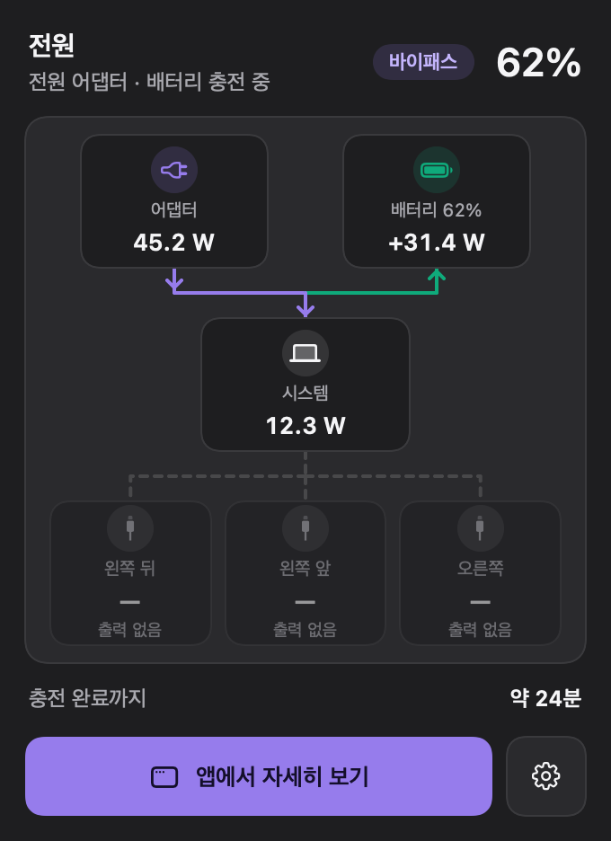
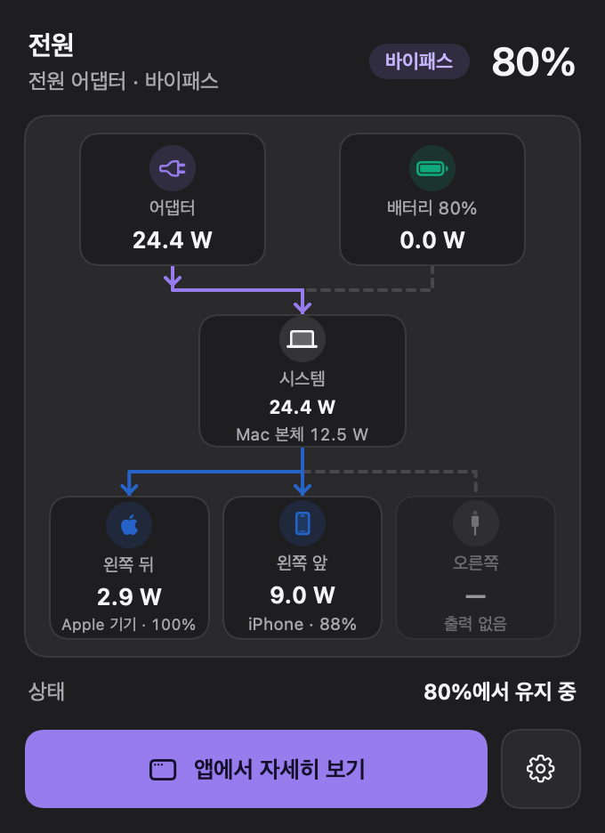
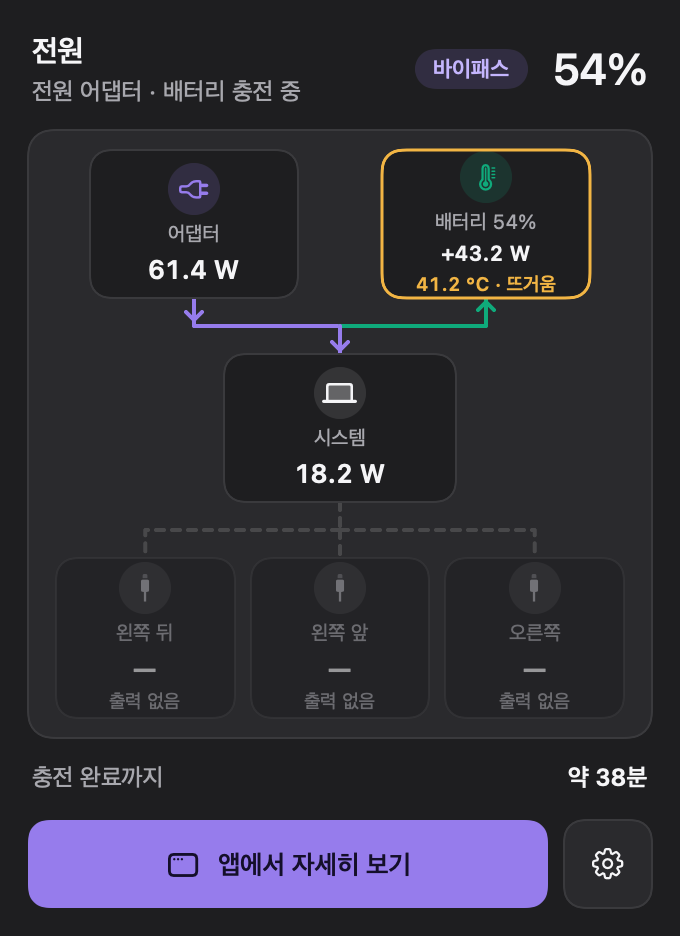
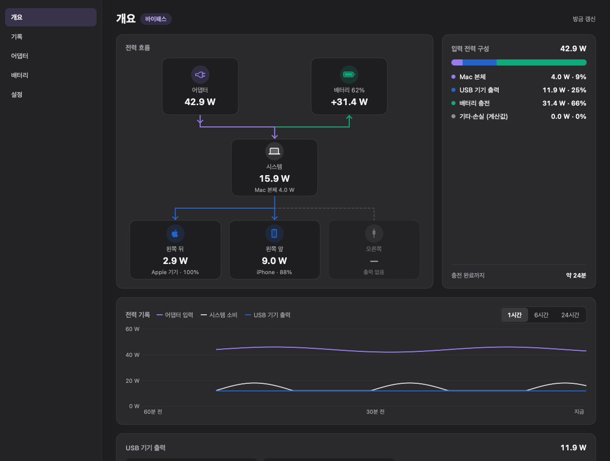

<div align="center">


# Zappie

**어댑터 → 시스템 / 배터리로 흐르는 전력을 실시간으로 보여주는 macOS 메뉴 막대 앱**

<br/>


</div>

---

<p align="center">
  
  
  
</p>

<p align="center">
  
</p>

## 기능

- **실시간 전력 흐름**: 어댑터 → 시스템 → 배터리, 그리고 각 USB-C 포트로 나가는 전력을 와트 단위로 보여 줍니다. 값은 SMC에서 매초 읽고, 배터리 드라이버 값과 자동으로 교차 검증해 어긋나면 드라이버 값으로 바꿉니다.
- **포트별 기기**: USB-C 포트에 연결된 기기 이름과 그 기기의 배터리 %(iPhone 등)를 표시합니다.
- **상태 구분**: 충전 중 / 바이패스(배터리를 거치지 않고 어댑터가 직접 공급) / 배터리 사용 / 배터리 보조(어댑터가 모자라 배터리가 함께 공급).
- **어떤 포트로 충전 중인지**: MagSafe인지 USB-C 몇 번 포트인지, 협상된 최대 전력까지 표시합니다.
- **배터리 온도 경고**: 40 °C 이상이면 경고와 알림을 보내고, macOS가 온도 때문에 충전을 늦추는 동안에는 따로 표시합니다.
- **메인 창**: 입력 전력 구성, 최근 1·6·24시간 기록 차트, 어댑터·배터리 세부 정보(전압·전류·사이클·최대 용량).
- **가볍게**: 메뉴 막대만 켜 둔 상태에서 CPU 1% 미만.

Zappie는 **읽기 전용** 모니터링 앱입니다. 충전 한도·방전 같은 충전 제어는 하지 않습니다. 충전 한도는 macOS 기본 기능(시스템 설정 → 배터리)을 쓰세요.

## 지원 기기

| | |
|---|---|
| Mac | Apple Silicon MacBook (Intel Mac·데스크톱 Mac 미지원) |
| macOS | 14 Sonoma 이상 |
| 직접 확인한 기기 | MacBook Pro M5 Pro (Mac17,9), macOS 27 |

다른 MacBook에서도 동작하도록 만들었지만 직접 확인하지는 못했습니다. 확인되지 않은 모델은 포트 이름이 "왼쪽 뒤" 대신 "USB-C 1"처럼 번호로 나옵니다.

## 설치 (소스에서 빌드)

필요한 것: Xcode 26 이상(앱 아이콘이 Icon Composer `.icon` 형식), [XcodeGen](https://github.com/yonaskolb/XcodeGen) (`brew install xcodegen`)

```bash
git clone https://github.com/mxvixxn/Zappie.git
cd Zappie
scripts/install.sh
```

Release로 빌드해 `/Applications/Zappie.app`에 설치하고 실행합니다. Apple Development 인증서가 있으면 그것으로, 없으면 ad-hoc으로 서명합니다. 로그인할 때 자동으로 켜려면 메인 창의 **설정 → 로그인 시 실행**을 켜세요.

## 개발

```bash
scripts/test.sh
```

단위 테스트를 실행합니다. `TEST_RUNNER_ZAPPIE_RENDER_DIR=<폴더> scripts/test.sh`로 실행하면 드롭다운·메인 창 화면을 PNG로 저장합니다. 데이터 소스(IOKit·SMC 키), 상태 판정 규칙, 디자인 토큰은 [docs/SPEC.md](docs/SPEC.md)에 정리되어 있습니다.
